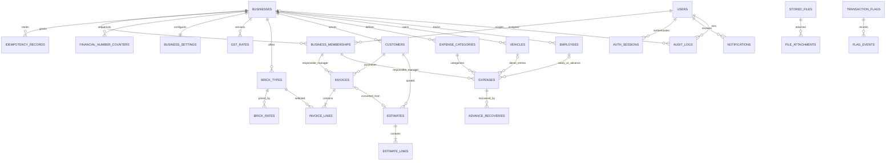

# Phase 1 Database Schema

PostgreSQL schema for Nivedha Groups Phase 1 (Chamber Bricks). UUID primary keys are used throughout. Business-owned records carry `business_id`; global identities and authentication records do not. Financial records are soft-deleted and retain snapshots of values used when issued.

## Entity Relationship Diagram

## Tables

| Area | Tables | Purpose |
| --- | --- | --- |
| Organization and access | `businesses`, `users`, `business_memberships` | Group businesses, global user identity and manager/assistant-manager business assignments. `users.organization_role` is for Super Admin, Admin, or CEO; those roles are group-wide. |
| Authentication | `otp_challenges`, `otp_rate_limits`, `auth_sessions` | Hashed OTP challenge, expiry/attempt limits, request throttling, and hashed rotating refresh-token sessions. |
| Request safety | `idempotency_records` | Business-scoped request hash and committed response for safely retrying invoice/estimate create and conversion calls. |
| Business setup | `business_settings`, `gst_rates`, `brick_types`, `brick_rates` | Company/GST details, effective-dated GST configuration, brick catalog, and effective-dated brick prices. |
| Customers and sales | `customers`, `financial_number_counters`, `invoices`, `invoice_lines`, `estimates`, `estimate_lines` | Per-business customer ledger, transactionally allocated financial-year sequences, issued invoices and estimates. |
| Expenses | `expense_categories`, `vehicles`, `employees`, `expenses`, `advance_recoveries` | Daily, diesel, salary, salary advance, and miscellaneous expenses; employee/person and vehicle references; recovery ledger for advances. |
| Files and sharing | `stored_files`, `file_attachments`, `share_links` | Persistent backend file metadata, optional expense attachments, and revocable share tokens. Estimate PDFs and links expire after 24 hours; estimate records remain. Invoice PDFs and links have no automatic expiry. |
| Governance | `transaction_flags`, `flag_events`, `notifications`, `device_tokens`, `audit_logs` | Doubtful transaction workflow and history, in-app/push delivery, and immutable before/after audit records. |

## Data Rules

- Customer mobile is unique within a business. Invoice and estimate numbers are unique by business and Indian financial year (April 1 to March 31).
- `invoice_lines` and `estimate_lines` snapshot the selected brick description, quantity, and effective rate. Invoices and estimates snapshot company/customer details, GST choice/rate, tax amounts, discount, and totals so later edits to settings or customer data do not change historical documents. Invoices and expenses carry a responsible business manager membership for doubtful-transaction notifications.
- GST is opt-in per invoice/estimate via `apply_gst`. `gst_rates` stores effective-dated business rates; invoice-level calculations snapshot CGST/SGST or IGST amounts. The service validates state-code routing and rounding.
- `business_id` is indexed on tenant-owned records. Customer, invoice, estimate, line, expense, and recovery relationships use composite business-aware foreign keys where applicable. All list queries must still enforce business authorization in the API.
- Financial rows use `deleted_at` for soft deletion. Audit logs are append-only and accessible only to Super Admin. Flagging creates a new `transaction_flags` row; state changes are appended to `flag_events`, allowing re-flagging after resolution.
- Invoice/estimate numbering is allocated transactionally per business, record type, and financial year through `financial_number_counters`; a unique constraint on each document remains the final guard.
- `stored_files.storage_path` points inside persistent storage organized by business and date. Store share tokens as hashes, not raw tokens. Invoice URLs are revocable; estimate share links and PDF files receive a 24-hour `expires_at`.
- `advance_recoveries` are recorded against the original `salary_advance` expense. Outstanding balance is derived as advance amount minus recoveries; recovery totals must not exceed the original advance.
- Store money as `NUMERIC`, never floating point. The API formats INR using Indian grouping; all timestamps are timezone-aware and business defaults to `Asia/Kolkata`.

## Model and Migration Entry Points

Alembic's `target_metadata` should use `app.db.base.Base.metadata` after importing `app.models`. Generate and review the initial migration with Alembic after installing the backend dependencies; do not use `Base.metadata.create_all()` in production. Partial uniqueness for active effective-date ranges, strict flag/entity consistency, number allocation, estimate conversion, permissions, and audit creation are enforced by service transactions in addition to database constraints.

The ORM definitions are in `backend/app/db/base.py` and `backend/app/models/`.